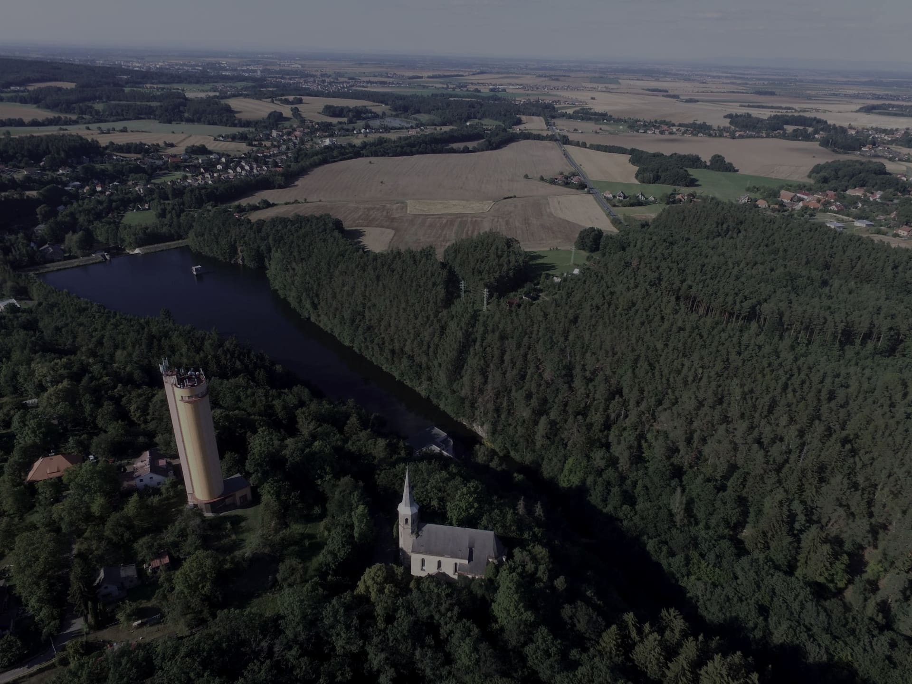

<div align="center">



# Zachraňme Práčov

**Charitativní web pro záchranu gotického kostela sv. Jakuba Většího v Práčově u Chrudimi**

[](https://juste-1.github.io/StrankaKostel/)
[](https://github.com/justE-1/StrankaKostel/actions/workflows/deploy.yml)


### [→ Otevřít web](https://juste-1.github.io/StrankaKostel/)

</div>

---

## O kostele

Kostel sv. Jakuba Většího vznikl v letech 1360–1380 jako součást benediktinského proboštství.
Je to zapomenutý klenot lucemburské gotiky nad Chrudimkou. Šest set let stojí, dnes je
v havarijním stavu. Web představuje jeho historii a etapy záchrany: odstranění náletů,
novou střechu a statické zajištění. Zároveň umožňuje snadno přispět.

## Jak přispět

| | |
|---|---|
| **Číslo účtu** | `6755789369/0800` |
| **IBAN** | `CZ39 0800 0000 0067 5578 9369` |
| **Příjemce** | Římskokatolická farnost Licibořice, IČO 43498469 |

QR platba a potvrzení o vedení účtu jsou přímo [na webu](https://juste-1.github.io/StrankaKostel/).

---

## Technologie

- **React 18 + Vite + TypeScript**, bez UI frameworku
- **Čisté CSS** s designovými tokeny, jedna komponenta = jeden CSS soubor
- Fotky ve **WebP + JPG**, QR platba ve formátu **SPAYD** ověřená zpětným dekódováním
- Ohled na `prefers-reduced-motion` a spoření dat
- **GitHub Actions**: každý push do `main` web sestaví a nasadí na GitHub Pages

## Spuštění

```bash
npm install
npm run dev       # vývojový server na http://localhost:5173
npm run build     # produkční build do dist/
npm run preview   # náhled produkčního buildu
```

### Pomocné skripty

```bash
node scripts/prep-fotky.mjs   # zmenší zdrojové fotky do public/assets/foto (jpg + webp)
node scripts/qr-platba.mjs    # vygeneruje QR platbu (SPAYD), předtím ověří IBAN (mod 97)
node scripts/qr-overeni.mjs   # dekóduje QR zpět a porovná znak po znaku
```

## Struktura

```
src/
├── data/obsah.ts          # veškerý text a čísla na jednom místě
├── styles/tokens.css      # barvy, písma, rytmus
├── styles/global.css      # reset, plochy, řezy, oblouk, odkrývání
├── hooks/                 # useOdkryti, useMedia, useKopirovani
└── components/            # jedna komponenta + jedno CSS na sekci
public/
├── assets/foto/           # optimalizované fotografie
└── dokumenty/             # potvrzení o vedení účtu
```

## Designový systém

| Token | Hodnota | Použití |
|---|---|---|
| `--uhel` | `#0E0D0B` | hlavní tmavá plocha |
| `--kamen` | `#1F1C17` | první vrstva etap, sekce Výzva |
| `--papir` | `#E8E2D6` | světlá plocha, text na tmavém |
| `--papir-tlum` | `#B9AF9B` | sekundární text na tmavém |
| `--inkoust-tlum` | `#6B6152` | sekundární text na papírovém |
| `--mosaz` | `#B08D3F` | akcent: CTA, aktivní rok, focus |

Gotický oblouk je definován jednou v `components/Tvary.tsx` jako SVG `clipPath`
s `clipPathUnits="objectBoundingBox"`, takže se přizpůsobí jakékoli velikosti prvku.

## Zdroje

Texty vycházejí z článku Pavlíka a Koblížka (Ozvěny Slatiňan 12/2024), evidence NPÚ
a Sommerovy studie z roku 2001. Úplný seznam je v patičce webu.

Fotografie: snímky z dronu (2017), interiér (2026), dobové pohlednice a koncert ANTO (2025).

## Kontakt

Římskokatolická farnost Licibořice · [farnost-slatinany@seznam.cz](mailto:farnost-slatinany@seznam.cz) · +420 603 861 275
